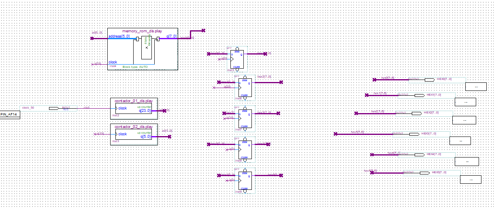

# Texto no Display — Sistemas Digitais

Experimento acadêmico da disciplina de **Sistemas Digitais da Universidade Federal de São Carlos (UFSCar)**. O circuito apresenta uma sequência de caracteres nos seis displays de sete segmentos da **Terasic DE10-Standard**, deslocando os padrões de um display para o seguinte.

A implementação utiliza **diagramas esquemáticos do Quartus Prime e componentes configurados no ambiente gráfico**. Os arquivos `.v` presentes no projeto são descrições geradas automaticamente para os IPs de contadores e ROM; não correspondem a um desenvolvimento manual do experimento em Verilog.

| Item | Configuração do projeto |
|---|---|
| Placa | Terasic DE10-Standard |
| Dispositivo | Cyclone V **5CSXFC6D6F31C6** |
| Ambiente de reprodução | **Quartus Prime 23.1**, com suporte a Cyclone V |
| Projeto e revisão | [texto_display.qpf](Texto_Display/texto_display.qpf), revisão `texto_display` |
| Nível superior | [texto_display.bdf](Texto_Display/texto_display.bdf), entidade `texto_display` |
| Entrada do topo | `clock_50`, referência de 50 MHz |
| Saídas do topo | `HEX0[7:0]` a `HEX5[7:0]` |
| Componentes | Dois contadores, ROM 64 × 8 e cinco bancos de flip-flops D |

## Objetivos

O experimento relaciona divisão de frequência, contagem binária, endereçamento de memória, codificação de caracteres e armazenamento sequencial. A ROM fornece os padrões luminosos; os flip-flops introduzem atrasos controlados, permitindo acompanhar o mesmo caractere em posições sucessivas.

O projeto integra duas práticas independentes. A outra utiliza padrões temporais nos LEDs e está disponível em [Texto no Ar](https://github.com/sd-ufscar/Texto-no-ar).

## Organização e arquivos principais

```text
TEXTO-NO-DISPLAY/
├── README.md
├── Texto_Display/
│   ├── texto_display.qpf / texto_display.qsf / texto_display.bdf
│   ├── contador_01_display.* / contador_02_display.*
│   ├── memory_rom_display.* / lab_04.mif
│   ├── esquematico.png / capturas de formas de onda
│   └── Lab_04/                     # Subpasta original preservada
├── comprimido/
│   ├── README-original.md
│   ├── TEXTO_DISPLAY.zip
│   └── result.zip
├── docs/
│   ├── inventario-local.csv
│   ├── validacao.md
│   └── relatorios-originais/
├── .gitattributes
└── .gitignore
```

| Arquivo | Função |
|---|---|
| [texto_display.qsf](Texto_Display/texto_display.qsf) | Dispositivo, topo, fontes, IPs e atribuições da revisão |
| [texto_display.bdf](Texto_Display/texto_display.bdf) | Integração gráfica dos componentes e das saídas HEX |
| [contador_01_display.qip](Texto_Display/contador_01_display.qip) | Descrição de integração do contador de 24 bits |
| [contador_02_display.qip](Texto_Display/contador_02_display.qip) | Integração do contador de endereços de 6 bits |
| [memory_rom_display.qip](Texto_Display/memory_rom_display.qip) | Integração da ROM de uma porta |
| [lab_04.mif](Texto_Display/lab_04.mif) | Conteúdo das 64 palavras de 8 bits da ROM |
| Arquivos `.bsf` | Símbolos utilizados no editor de esquemáticos |
| Arquivos `.v`, `_bb.v`, `_inst.v`, `.cmp` e `.inc` | Produtos e declarações auxiliares dos IPs gerados pelo Quartus |
| [Arquivo_Pinos_DE10_2V5.qsf](Texto_Display/Arquivo_Pinos_DE10_2V5.qsf) | Modelo geral de pinos da placa, separado da revisão ativa |

A subpasta `Texto_Display/Lab_04/` permanece na posição original. Para a reprodução principal, abrir o `.qpf` diretamente em `Texto_Display/`, sem alternar entre as duas cópias. O modelo geral de pinos contém referências de outro projeto, como `my_first_fpga`; não deve ser importado integralmente sobre a configuração ativa.

## Integração pelo esquemático



*Figura 1 — Dois contadores, ROM, cinco estágios DFF e saídas HEX. Os rótulos de rede estabelecem conexões entre pontos que não possuem um fio contínuo desenhado.*

O fluxo de funcionamento é:

1. `clock_50` alimenta `contador_01_display`, instância `inst2`.
2. O bit `q[23]` fornece o clock reduzido ao contador de endereços, à ROM e aos cinco estágios DFF.
3. `contador_02_display`, instância `inst3`, gera `ad[5:0]` para a entrada de endereço da ROM.
4. `memory_rom_display`, instância `inst4`, produz o padrão de oito bits da saída `HEX0`.
5. Os bancos DFF `inst5` a `inst9` propagam os padrões pelas redes `hex1` a `hex5`.

```text
ROM → HEX0 → banco DFF → HEX1 → banco DFF → HEX2
                                      → ... → HEX5
```

O diagrama textual resume a cadeia de dados; todos os bancos recebem o mesmo clock `q[23]`. Não há um clock diferente para cada display.

## Displays de sete segmentos

Um display é formado por sete segmentos que podem ser acionados independentemente. Na DE10-Standard, os segmentos são ativos em nível baixo: **0 acende e 1 apaga**. A identificação utilizada é:

```text
       0 (a)
      ─────
 5 (f)│   │1 (b)
      ─────  6 (g)
 4 (e)│   │2 (c)
      ─────
       3 (d)
```

Uma palavra da memória representa o padrão completo de um instante, e não um código ASCII a ser decodificado por software. O padrão `11111111` mantém os sete segmentos apagados; `11000001`, por exemplo, acende os segmentos 1, 2, 3, 4 e 5, formando uma aproximação de **U**.

Os barramentos do BDF possuem oito bits, mas os displays da placa possuem os segmentos conectados aos bits **0 a 6**. As atribuições fornecidas não fixam os seis sinais `HEXn[7]`; eles não devem ser interpretados como pontos decimais controlados neste experimento. Os relatórios originais mostram 49 pinos no topo, incluindo esses seis sinais adicionais. Antes de programar uma nova compilação, conferir no Pin Planner e no relatório de pinos o tratamento de todas as saídas, inclusive as não atribuídas.

As características físicas e o mapeamento dos segmentos são descritos no [manual da DE10-Standard, seção 3.6.2](https://www.mouser.com/datasheet/3/996/1/DE10-Standard_User_manual.pdf), documento da Terasic.

## Contadores e divisão de frequência

O primeiro contador é crescente, com **24 bits**, habilitação permanente e sem módulo de contagem reduzido configurado. Ele percorre as combinações binárias de 0 a `2^24 − 1`. A divisão utiliza diretamente o bit mais significativo `q[23]`, não um PLL.

Para o bit de índice `n` de um contador binário:

```text
f(q[n]) = f_entrada / 2^(n+1)

f(q[23]) = 50.000.000 / 16.777.216 ≈ 2,980232 Hz
T(q[23]) = 0,33554432 s
```

O segundo contador é crescente, com **6 bits**, e utiliza essa referência reduzida. Sua saída percorre endereços de 0 a 63. O percurso completo da memória leva teoricamente `64 × 0,33554432 = 21,47483648 s`.

Esses tempos são calculados a partir dos parâmetros encontrados e da referência nominal de 50 MHz. Não são medições realizadas na placa. A divisão por contador também não constitui uma certificação de temporização dos caminhos derivados.

## ROM e codificação dos caracteres

A ROM possui **64 endereços de 8 bits**, totalizando 512 bits. O IP utiliza `lab_04.mif` como arquivo de inicialização e uma saída registrada pelo clock, com `outdata_reg_a = "CLOCK0"`.

O conteúdo repete oito vezes a sequência abaixo:

| Endereço no bloco de 8 | Palavra binária | Hexadecimal | Forma representada pelos segmentos |
|---|---|---|---|
| 0 | `11000001` | `C1` | U |
| 1 | `10001110` | `8E` | F |
| 2 | `10010010` | `92` | S |
| 3 | `11000110` | `C6` | C |
| 4 | `10001000` | `88` | A |
| 5 | `10101111` | `AF` | r |
| 6 e 7 | `11111111` | `FF` | Espaço, com segmentos apagados |

As formas são aproximações possíveis com sete segmentos. A mesma sequência reaparece nos endereços 8–15, 16–23 e assim por diante, até 56–63. Logo, o conteúdo visual da ROM se repete a cada **oito atualizações**, equivalentes a aproximadamente **2,68435456 s**, embora o contador de endereços só retorne a zero após 64 atualizações.

O arquivo `.mif` é uma dependência de síntese e inicialização da memória. Sua extensão não indica um arquivo temporário; removê-lo altera ou impede a obtenção do conteúdo esperado da ROM.

## Flip-flops D e deslocamento do texto

O flip-flop D conserva o valor da entrada `D` a partir de uma borda ativa do clock e o disponibiliza em `Q`. No esquema, os símbolos DFF são usados em barramentos de oito bits: cada etapa armazena uma palavra de segmentos.

Todos os estágios amostram simultaneamente. Assim, cada banco recebe o valor que estava disponível no estágio anterior antes da borda; um caractere não atravessa instantaneamente toda a cadeia. Em regime estável, considerando `R[k]` a palavra observada na saída registrada da ROM após uma atualização:

| Display | Palavra correspondente |
|---|---|
| HEX0 | `R[k]` |
| HEX1 | `R[k−1]` |
| HEX2 | `R[k−2]` |
| HEX3 | `R[k−3]` |
| HEX4 | `R[k−4]` |
| HEX5 | `R[k−5]` |

Esse quadro explica o atraso entre os displays; não especifica uma latência absoluta entre uma mudança de endereço e a saída interna da ROM. O endereço e a memória também dependem do mesmo clock, e a ROM possui registros próprios.

O topo não disponibiliza entradas de reset, botões de avanço ou seleção de velocidade. Os nomes de chaves e botões presentes no modelo geral de pinos não representam controles do circuito. O preenchimento inicial da cadeia não deve ser confundido com o comportamento periódico já estabelecido.

## Capturas de formas de onda disponíveis


*Figura 2 — Captura disponível no conjunto original, útil para visualizar o atraso de uma palavra entre saídas sucessivas.*

A captura apresenta palavras como `11000000` e `11111101`, diferentes da sequência inicial `C1, 8E, 92, C6, 88, AF` do `.mif` publicado. Portanto, ela ilustra a propagação temporal registrada, mas **não comprova a simulação do conteúdo atual da ROM**. Sua escala também não deve substituir o cálculo de frequência a partir dos parâmetros ativos.

As capturas individuais estão preservadas: [HEX0](Texto_Display/%7B09A08CCA-DC25-4C88-BAEB-B44852233F7D%7D.png), [HEX1](Texto_Display/%7BD6D62BFE-F6EF-4F5C-92AE-D3C165FC6007%7D.png), [HEX2](Texto_Display/%7BC80F8C87-7FC6-4D98-9332-CB5D3A6E23ED%7D.png), [HEX3](Texto_Display/%7BF6AB1FBC-D99E-4F3E-803C-A99E7EDCF8B6%7D.png), [HEX4](Texto_Display/%7B67414CFA-D2DA-4490-BF84-836BCE65DED3%7D.png) e [HEX5](Texto_Display/%7B9E30ADAC-0FC1-4590-99A8-405D6C13A9C4%7D.png). Não foi encontrado um arquivo de estímulos `.vwf` junto às fontes.

## Abrir, compilar e programar

1. Instalar o **Quartus Prime 23.1**, com suporte ao Cyclone V e driver do **USB-Blaster II** da placa. O QSF registra a última utilização como `23.1std.0 Lite Edition`, e os IPs declaram 23.1. Entretanto, o QPF conserva **`QUARTUS_VERSION = "25.1"`**, e o campo de criação do QSF também menciona 25.1. Esses metadados permanecem intactos. A abertura deste conjunto no Quartus 23.1 não foi verificada; caso apareça um aviso de versão, conferir os arquivos e os relatórios antes de salvar uma conversão em uma cópia de trabalho.
2. Obter o repositório:

   ```sh
   git clone https://github.com/sd-ufscar/TEXTO-NO-DISPLAY.git
   cd TEXTO-NO-DISPLAY
   ```

3. Em **File → Open Project**, abrir `Texto_Display/texto_display.qpf`. Conferir a revisão `texto_display`.
4. Em **Assignments → Device**, confirmar **5CSXFC6D6F31C6**. Em **Assignments → Settings**, conferir a entidade superior `texto_display` e o BDF correspondente.
5. Em **Project → Add/Remove Files in Project**, conferir o BDF, os três `.qip` e `lab_04.mif`. Os QIPs relacionam os arquivos gerados dos componentes; não substituir os IPs por implementações manuais.
6. Abrir o BDF e inspecionar os dois contadores, a ROM e os cinco bancos DFF. Os parâmetros podem ser conferidos pelas ferramentas de IP do Quartus, mantendo seus valores originais.
7. No **Pin Planner**, conferir `clock_50` em **AF14** e os segmentos `HEX0[6:0]` a `HEX5[6:0]` conforme o QSF e o manual. Conferir separadamente os sinais `HEXn[7]` sem pinos fixados. Os relatórios de referência registram I/O de 2,5 V; a adequação elétrica deve ser conferida com a placa e o manual antes da gravação.
8. Selecionar **Processing → Start Compilation**. Verificar Analysis & Synthesis, Fitter, Assembler e Timing Analyzer. O arquivo de programação esperado após conclusão é `Texto_Display/output_files/texto_display.sof`.
9. Conectar o cabo USB ao conector **USB-Blaster II**, alimentar a placa conforme seu manual e abrir **Tools → Programmer**. Selecionar **Hardware Setup → USB-Blaster II** e modo **JTAG**.
10. Usar **Auto Detect** quando necessário. Associar o `.sof` recém-gerado ao dispositivo FPGA correspondente, marcar **Program/Configure** e selecionar **Start**. A cadeia pode incluir o HPS; não associar o `.sof` a outro dispositivo da cadeia.
11. Conferir a conclusão da programação e observar os seis displays por vários ciclos. O comportamento esperado pelas fontes é a sequência de padrões da ROM, com propagação `HEX0 → HEX1 → ... → HEX5`.

Com `quartus_sh` disponível, a compilação também pode ser iniciada no terminal, a partir de `Texto_Display/`:

```sh
quartus_sh --flow compile texto_display
```

A gravação JTAG por `.sof` é volátil. O projeto não implementa comandos por KEY ou SW para iniciar, pausar ou reiniciar a sequência. Uma nova programação reinicializa a configuração da FPGA; não equivale a um botão de reset previsto pelo esquema.

## Preservação e validação

Os arquivos preexistentes continuam disponíveis em [comprimido/README-original.md](comprimido/README-original.md), [comprimido/TEXTO_DISPLAY.zip](comprimido/TEXTO_DISPLAY.zip) e [comprimido/result.zip](comprimido/result.zip), sem mudanças de conteúdo. Os fontes individuais estão em `Texto_Display/`; não foi criado um ZIP substituto.

Os originais locais e todos os arquivos de projeto publicados são preservados byte a byte. O [inventário](docs/inventario-local.csv) registra também os arquivos regeneráveis excluídos do versionamento. A [validação detalhada](docs/validacao.md) apresenta as conferências de integridade, dependências e limites de reprodução.

Os relatórios originais registram uma compilação em **22 de outubro de 2026**, com Fitter concluído, 26 ALMs, 74 registradores e 512 bits de memória. Também apresentam ausência de `texto_display.sdc` e folgas negativas de temporização; esse histórico não comprova fechamento temporal. **A preparação desta publicação não executou uma nova compilação, simulação ou demonstração física**, pois o Quartus e a placa não estavam disponíveis no ambiente de validação.
